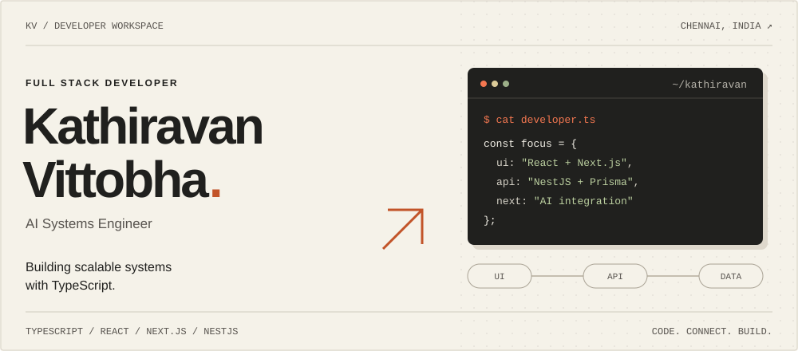

<!--
Kathiravan Vittobha | Full Stack Developer & AI Systems Engineer
TypeScript, React, Next.js, NestJS, Node.js, PostgreSQL, Prisma, AI Integration
Portfolio: https://kathiravanvittobha.com
-->




**[Portfolio ↗](https://kathiravanvittobha.com/)** &nbsp; / &nbsp; **[Email ↗](mailto:kathiravanvittopa717@gmail.com)** &nbsp; / &nbsp; **[LinkedIn ↗](https://www.linkedin.com/in/kathiravan-vittobha-182569317/)**

[01 — Profile](#01--profile) &nbsp; [02 — Toolkit](#02--toolkit) &nbsp; [03 — Expertise](#03--expertise) &nbsp; [04 — Journey](#04--journey) &nbsp; [05 — Connect](#05--connect)

## 01 / Profile

<table>
<tr>
<td width="62%" valign="top">
<h3>Hey, I'm Kathiravan Vittobha.</h3>
<p>Full Stack Developer building production systems with TypeScript, React, and NestJS.</p>
<p>Full-stack development spanning modern frontends, robust backends, and AI-integrated systems that solve real business problems.</p>
<p><strong>Building</strong><br />Scalable systems, Email Inbox Apps, AI-Integrated Applications</p>
</td>
<td width="38%" valign="top">
<p><sub>CURRENTLY</sub><br /><strong>Full-Stack Developer</strong><br />VSTN Technologies</p>
<p>Building scalable web applications and enterprise solutions.</p>
<p><sub>BASED IN</sub><br />Chennai, Tamil Nadu, India</p>
<p><sub>FOCUS</sub><br />TypeScript · React · Next.js · NestJS<br />AI Integration · Cloud Architecture</p>
</td>
</tr>
</table>

> **Ask me about** TypeScript, React Hooks patterns, NestJS architecture, or building scalable applications.

<details>
<summary>View profile as TypeScript</summary>

```typescript
const developer = {
  name: "Kathiravan Vittobha",
  role: "Full Stack Developer & AI Systems Engineer",
  location: "Chennai, Tamil Nadu, India",
  focus: ["TypeScript", "React", "Next.js", "NestJS", "AI Integration", "Cloud Architecture"],
  building: "Scalable systems, Email Inbox Apps, AI-Integrated Applications",
  portfolio: "kathiravanvittobha.com"
};
```

</details>

## 02 / Toolkit

| Layer | Technologies |
| :--- | :--- |
| **Languages** | `TypeScript` · `JavaScript` · `Python` |
| **Frontend** | `React` · `Next.js` · `TailwindCSS` · `Mantine UI` · `Recharts` |
| **Backend** | `Node.js` · `NestJS` · `Express.js` · `Prisma` |
| **Data & storage** | `PostgreSQL` · `MongoDB` · `Supabase` |
| **Cloud & deployment** | `AWS` · `Azure` · `Firebase` · `Vercel` · `Railway` · `Docker` · `Git` |
| **AI & integrations** | `Groq` · `NextAuth` · `Microsoft Graph` · `Gmail API` · `SharePoint` |

## 03 / Expertise

<table>
<tr>
<td width="50%" valign="top">
<p><sub>01 / EXPERTISE</sub></p>
<h3>Full-Stack Web Development</h3>
<p>Build modern, scalable web applications from frontend to backend using React, Next.js, Node.js, and NestJS.</p>
<ul><li>React &amp; Next.js frontend development</li><li>Node.js &amp; NestJS backend APIs</li><li>Database design &amp; optimization</li><li>Responsive &amp; accessible UI/UX</li></ul>
</td>
<td width="50%" valign="top">
<p><sub>02 / EXPERTISE</sub></p>
<h3>AI Integration &amp; Automation</h3>
<p>Integrate cutting-edge AI capabilities into your applications using Groq API and other AI services.</p>
<ul><li>LLM API integration</li><li>AI-powered features</li><li>Automation workflows</li><li>Smart content generation</li></ul>
</td>
</tr>
<tr>
<td width="50%" valign="top">
<p><sub>03 / EXPERTISE</sub></p>
<h3>CRM &amp; Enterprise Solutions</h3>
<p>Custom CRM systems and enterprise applications designed for complex business workflows.</p>
<ul><li>CRM system development</li><li>Business process automation</li><li>Data management solutions</li><li>SharePoint integration</li></ul>
</td>
<td width="50%" valign="top">
<p><sub>04 / EXPERTISE</sub></p>
<h3>Invoicing &amp; Financial Systems</h3>
<p>Comprehensive invoicing platforms and financial dashboards with PDF generation and payment integration.</p>
<ul><li>Invoicing system development</li><li>PDF generation</li><li>Payment gateway integration</li><li>Financial reporting dashboards</li></ul>
</td>
</tr>
<tr>
<td width="50%" valign="top">
<p><sub>05 / EXPERTISE</sub></p>
<h3>Data Visualization &amp; Dashboards</h3>
<p>Interactive dashboards for analytics, reporting, and business intelligence with real-time data updates.</p>
<ul><li>Interactive visualizations</li><li>Real-time data dashboards</li><li>Business analytics</li><li>Reporting solutions</li></ul>
</td>
<td width="50%" valign="top">
<p><sub>06 / EXPERTISE</sub></p>
<h3>Cloud Deployment &amp; DevOps</h3>
<p>Deployment, scaling, and infrastructure management on AWS, Azure, and Firebase platforms.</p>
<ul><li>AWS cloud solutions</li><li>Azure deployment</li><li>Firebase setup</li><li>CI/CD pipelines</li></ul>
</td>
</tr>
</table>

## 04 / Journey

<table>
<tr>
<td width="66%" valign="top">
<p><sub>2024 — PRESENT / EXPERIENCE</sub></p>
<h3>VSTN Technologies</h3>
<p><strong>Full Stack Developer</strong><br />Chennai, Tamil Nadu</p>
<p>Building scalable web applications with modern tech stack:</p>
<ul>
<li>Full-stack development with React, Next.js, Node.js, and NestJS</li>
<li>Database design and optimization using PostgreSQL and Prisma</li>
<li>Building responsive, accessible UI/UX components</li>
<li>Enterprise application development and CRM systems</li>
<li>API integration and backend architecture</li>
<li>Cloud deployment and infrastructure management</li>
</ul>
<p><strong>Technologies:</strong> React · Next.js · NestJS · TypeScript · PostgreSQL · Prisma · Mantine UI · Node.js</p>
</td>
<td width="34%" valign="top">
<p><sub>2021 — 2024 / EDUCATION</sub></p>
<h3>Vellore Institute of Technology (VIT)</h3>
<p><strong>BSc Computer Science</strong><br />Vellore, Tamil Nadu</p>
</td>
</tr>
</table>

<details>
<summary><strong>GitHub activity & developer quote</strong></summary>

### GitHub Stats


### Random Dev Quote


</details>

## 05 / Connect

### Have something in mind? Let's talk.

[Portfolio ↗](https://kathiravanvittobha.com) &nbsp; / &nbsp; [GitHub ↗](https://github.com/KathiravanBCS) &nbsp; / &nbsp; [LinkedIn ↗](https://www.linkedin.com/in/kathiravan-vittobha-182569317/) &nbsp; / &nbsp; [X / Twitter ↗](https://x.com/Kathiravan27117) &nbsp; / &nbsp; [Email ↗](mailto:kathiravanvittopa717@gmail.com) &nbsp; / &nbsp; [Peerlist ↗](https://peerlist.io/kathiravan)

---

<sub>Kathiravan Vittobha · Full Stack Developer & AI Systems Engineer · Chennai, India</sub>


